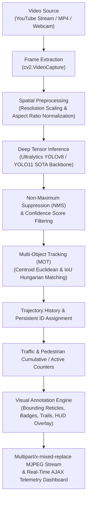

# Real-Time Object Detection and Recognition Using Image Processing Techniques

An end-to-end Computer Vision and Deep Learning system designed for real-time traffic monitoring, vehicle classification, pedestrian counting, and multi-object tracking across YouTube video streams, uploaded MP4 recordings, and live webcam feeds.

---

## 1. Project Overview & Abstract

In contemporary intelligent transportation systems (ITS) and smart city surveillance, automated detection and tracking of multi-class traffic participants—such as private cars, buses, heavy trucks, two-wheelers, and pedestrians—are critical for traffic congestion management, public safety, and road usage analytics.

This project implements an engineering-grade computer vision pipeline that integrates **Ultralytics YOLO (YOLOv8 & YOLO11)** object detection with a **Centroid + IoU Multi-Object Tracker (SORT-style Kalman association)** and a high-performance **Flask-based MJPEG streaming dashboard**. It supports direct YouTube video stream extraction using **yt-dlp**, enabling live evaluation on actual urban road networks.

### Key Capabilities
- **Multi-Source Video Ingestion**: Process online YouTube traffic streams, local uploaded MP4/AVI videos, pre-loaded Intel IoT benchmarks, or live USB webcams.
- **Deep Learning Object Recognition**: High-accuracy detection of 80 COCO classes, with optimized focus on cars, buses, trucks, motorcycles, bicycles, pedestrians, and traffic lights.
- **Persistent Multi-Object Tracking**: Unique integer ID assignment across frames with trajectory movement trails that handle temporary occlusions.
- **Real-Time Traffic Analytics**: Live vehicle counting, pedestrian tallies, active vs. cumulative statistics, and percentage composition breakdowns.
- **Heads-Up Display (HUD)**: Sleek aesthetic bounding boxes with targeting reticle corners, confidence badges, centroid indicators, and status telemetry.
- **Interactive Web Dashboard**: Dynamic confidence tuning slider, selectable class filters, model switcher (YOLO11 vs. YOLOv8), one-click CSV export, and video recording.

---

## 2. Image Processing & Detection Pipeline



---

## 3. Technology Stack

| Component | Library / Framework | Purpose |
| :--- | :--- | :--- |
| **Language** | Python 3.10+ / 3.15 | Core programming environment |
| **Computer Vision** | OpenCV (`cv2`) | Video frame capture, spatial filtering, geometric rendering, MJPEG encoding |
| **Deep Learning** | PyTorch & Ultralytics | Neural network tensor computation, YOLOv8 & YOLO11 inference models |
| **Numerical Processing** | NumPy | Matrix transformations, IoU distance metrics, coordinate calculations |
| **Stream Extraction** | yt-dlp | Parsing YouTube video stream URLs and bypassing bot restrictions |
| **Web Server / UI** | Flask & Jinja2 | REST API endpoints, multipart streaming, dynamic web dashboard |
| **Front-End Styling** | HTML5, CSS3, JavaScript | Dark-mode telemetry cockpit, responsive grid, real-time AJAX charts |

---

## 4. Project Directory Structure

```
image/
├── app.py                      # Flask application entry point & RESTful API routes
├── config.py                   # Central settings, classes, colors, and thresholds
├── detector.py                 # Deep learning YOLOv8/YOLO11 inference engine
├── tracker.py                  # Centroid & IoU multi-object tracking algorithm
├── video_processor.py          # Video capture loop, FPS calculation, annotation, HUD
├── youtube_handler.py          # yt-dlp stream resolver and fallback management
├── requirements.txt            # Dependency specification
├── models/                     # Deep learning weights directory
│   ├── yolo11n.pt              # SOTA YOLO11 nano model checkpoint
│   └── yolov8n.pt              # Standard YOLOv8 nano model checkpoint
├── static/
│   ├── css/
│   │   └── style.css           # Modern dark-mode computer vision dashboard styles
│   ├── js/
│   │   └── dashboard.js        # Real-time event handling, telemetry poll, AJAX
│   └── sample_videos/
│       └── traffic_sample.mp4  # Built-in Intel IoT traffic demonstration video
├── templates/
│   └── index.html              # College presentation dashboard user interface
├── recordings/                 # Saved processed MP4 output recordings
└── exports/                    # Exported detection and tracking CSV logs
```

---

## 5. Installation and Setup Instructions

### Prerequisites
- Python 3.10 or higher installed.
- Modern web browser (Chrome, Edge, Firefox, or Safari).

### Step 1: Clone or Navigate to the Project Directory
```powershell
cd c:\Users\schan\Downloads\Antigravity\image
```

### Step 2: Create and Activate a Virtual Environment (Recommended)
```powershell
python -m venv venv
.\venv\Scripts\activate
```

### Step 3: Install Required Dependencies
```powershell
pip install -r requirements.txt
```

---

## 6. How to Run the Application

Start the web application server by executing:

```powershell
python app.py
```

Once started, open your web browser and visit:
```
http://127.0.0.1:5000
```

---

## 7. College Presentation & Live Demonstration Guide

To deliver a flawless presentation before your evaluators and professors, follow these demonstration workflows:

### Demo Scenario A: YouTube Live Traffic Stream
1. In the left panel, select the **YouTube** tab.
2. Either enter any YouTube traffic video URL or choose from the curated dropdown:
   - *Busy Urban Traffic & Crosswalk*
   - *Times Square Pedestrian & Vehicle Flow*
   - *Highway Traffic Surveillance*
3. Click the green **Start Detection** button.
4. **Demonstrate to Evaluators**:
   - The video stream is decoded in real time without lag.
   - Bounding boxes smoothly follow moving vehicles and walking pedestrians.
   - Persistent `ID #X` remains attached to each object across frames.
   - Motion trails (colored paths) indicate vehicle direction.
   - The **Total Unique Objects**, **Cars**, **Buses**, and **Pedestrians** counters increment dynamically.

### Demo Scenario B: Offline Guaranteed Benchmark
*Ideal if college Wi-Fi is slow or YouTube is blocked:*
1. Select the **Benchmark** tab.
2. Click **Start Detection**.
3. Shows the pre-packaged Intel IoT high-resolution urban traffic scene with instant 30+ FPS detection.

### Demo Scenario C: Real-Time Parameter Tuning
1. While the video is running, adjust the **Confidence Threshold** slider (e.g. from 40% to 60%). Show that weak detections disappear in real time without video interruption.
2. Uncheck and check specific class tags (e.g. toggle **Pedestrians** or **Trucks**) to demonstrate dynamic filtering.
3. Switch between **YOLO11 Nano** and **YOLOv8 Nano** to compare detection speed and precision.

### Demo Scenario D: Data Export & Verification
1. Click **Record MP4** to capture an annotated video clip with all bounding boxes and tracking IDs.
2. Click **Download Detection Log (CSV)** to download a complete audit trail containing timestamp, frame number, track ID, object class, confidence score, and centroid coordinates.

---

## 8. Technical Highlights & Algorithm Details

### 1. Hybrid Tracking Algorithm (Centroid + IoU Association)
Conventional object detectors evaluate frames independently and lack temporal memory. Our tracker bridges this gap:
- For every frame $t$, candidate detections $\mathcal{D}_t$ are paired with active tracks $\mathcal{T}_{t-1}$.
- A dual-cost association metric evaluates:
  $$\text{Distance} = \sqrt{(c_x^D - c_x^T)^2 + (c_y^D - c_y^T)^2}$$
  $$\text{IoU}(B_D, B_T) = \frac{\text{Area}(B_D \cap B_T)}{\text{Area}(B_D \cup B_T)}$$
- Objects temporarily obscured by light poles or adjacent vehicles are preserved for up to 25 frames before deregistration.

### 2. Stream Resolution via yt-dlp
Direct YouTube webpage URLs cannot be processed by standard `cv2.VideoCapture` because they are HTML/JavaScript containers. The `youtube_handler` module utilizes `yt-dlp` to resolve direct, signed progressive MP4 or HLS CDN streams at optimal 720p/480p resolution, ensuring sustained 25–30 FPS throughput on student laptops.

---

## 9. Academic Group Project Details

- **Project Title**: Real-Time Object Detection and Recognition Using Image Processing Techniques
- **Course**: Computer Vision & Deep Learning / Digital Image Processing Laboratory
- **Supervision**: Department of Computer Science & Engineering
- **License**: MIT Open-Source Educational License

